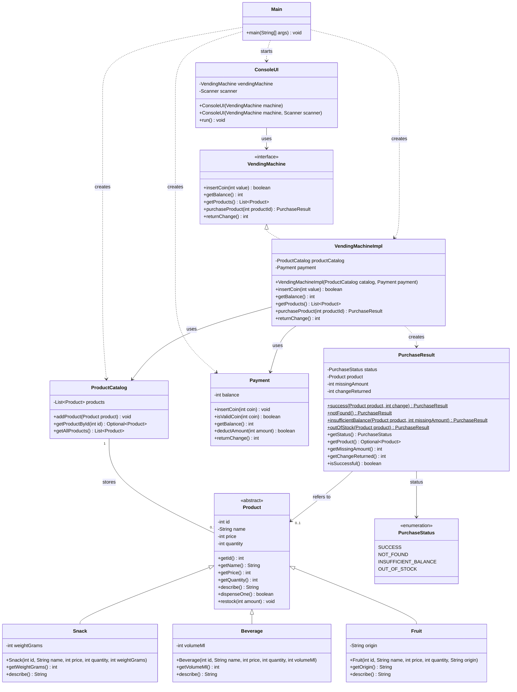

# Lexicon Workshop — Vending Machine

A Java 25 console application developed for the Lexicon object-oriented programming (OOP) workshop. The application sells snacks, beverages, and fruit, accepts predefined Swedish coin denominations, manages stock, processes purchases, and returns change. It uses Maven, JUnit 5, and GitHub Actions.

**Repository:** https://github.com/Padmaqaauto/Workshop-Vending-Machine

## Requirements and features

- Display available products with ID, name, price, category-specific description, and stock quantity.
- Accept **1, 2, 5, 10, 20, and 50 kr** coins; reject other values without changing the balance.
- Purchase by product ID and report `SUCCESS`, `NOT_FOUND`, `INSUFFICIENT_BALANCE`, or `OUT_OF_STOCK`.
- Leave stock and balance unchanged after an unsuccessful purchase.
- On success, dispense one product, deduct its price, and automatically return any remaining balance.
- Return the current balance on request or when the console exits.
- Keep domain rules separate from console input/output.
- Build a runnable JAR and verify behavior with automated tests.

The application stores its sample inventory **in memory**. Stock and balance reset when a new process starts; there is no database or persistent storage.

## Quick start

### Prerequisites

- **JDK 25** (`java -version` and `javac -version`)
- **Maven** (`mvn -version`)

### Build, test, and run

From the repository root:

```bash
mvn clean verify
java -jar target/workshop-vending-machine-1.0.0.jar
```

`mvn clean verify` compiles production and test classes, runs the JUnit tests, and creates the JAR. The Maven JAR plugin sets the manifest entry point to `se.lexicon.Main`.

To run the application in an IDE, launch `se.lexicon.Main.main(String[] args)`.

### Console menu

```text
1. Show products
2. Insert coin
3. Purchase product
4. Return change
0. Exit
```

The program lists products and the balance, and re displays the menu until the user exits or input ends. Sample inventory is created by `Main`; it includes a snack, two beverages, and a fruit.

**Example purchase:** Insert 50 kr (`2` then `50`), buy the 20 kr Chocolate Bar (`3` then product ID `1`), and receive the product with **30 kr** returned automatically. The balance becomes zero and the product stock decreases by one.

## Architecture

The application separates the console user interface, vending-machine operations, payment, and inventory.

| Class / type | Package | Responsibility |
|---|---|---|
| `Main` | `se.lexicon` | Creates the sample catalog, payment object, machine, and console UI; starts the application |
| `ConsoleUI` | `se.lexicon.ui` | Uses `Scanner` for menu input and displays product, purchase, balance, and refund messages |
| `VendingMachine` | `se.lexicon.vendingmachine` | Interface exposing coin insertion, balance, product listing, purchasing, and change return |
| `VendingMachineImpl` | `se.lexicon.vendingmachine` | Coordinates catalog lookup, stock checking, payment deduction, dispensing, and purchase outcomes |
| `ProductCatalog` | `se.lexicon.vendingmachine.catalog` | Stores `Product` objects in an `ArrayList`, checks duplicate IDs, looks up products, and returns an unmodifiable list snapshot |
| `Payment` | `se.lexicon.vendingmachine.payment` | Validates coin denominations, maintains the balance, performs conditional deductions, and returns change |
| `Product` | `se.lexicon.vendingmachine.product` | Abstract base class for shared product identity, price, stock, description, and stock operations |
| `Snack`, `Beverage`, `Fruit` | `se.lexicon.vendingmachine.product` | Specialized product descriptions for grams, milliliters, and origin |
| `PurchaseResult` | `se.lexicon.vendingmachine.purchase` | Immutable purchase-result data with status, optional product accessor, missing amount, and returned change |
| `PurchaseStatus` | `se.lexicon.vendingmachine.purchase` | Enum: `SUCCESS`, `NOT_FOUND`, `INSUFFICIENT_BALANCE`, `OUT_OF_STOCK` |

### UML class diagram — as implemented



### OOP concepts used

- **Abstraction and inheritance:** `Product` is abstract; the three product types inherit common behavior.
- **Polymorphism:** The console calls `Product.describe()` without testing concrete product types. `VendingMachineImpl` fulfills the `VendingMachine` interface.
- **Encapsulation:** Fields are private and exposed through operations, not direct modification. Constructors validate invalid product values.
- **Composition and delegation:** `VendingMachineImpl` holds a `ProductCatalog` and `Payment` instance and delegates specialized operations.
- **Collections and iteration:** `ProductCatalog` uses `ArrayList<Product>`; product lookup and console display iterate over products.
- **Control flow:** The console uses a `Scanner`, a loop, conditional checks, and `switch` statements.

### Purchase flow

1. The console sends a product ID to `VendingMachine.purchaseProduct(id)`.
2. The implementation looks up the product in `ProductCatalog`.
3. An unknown ID produces `NOT_FOUND`; zero quantity produces `OUT_OF_STOCK`.
4. If the balance is too small, `INSUFFICIENT_BALANCE` reports the missing amount without changing stock or balance.
5. A successful purchase deducts the price, dispenses one unit, returns any remaining balance, and creates `PurchaseResult.success(...)`.
6. `ConsoleUI` translates the result into a user-facing message.

`PurchaseResult.getProduct()` returns `Optional<Product>`; the underlying stored field is a nullable `Product`. The result validates status/amount combinations, including zero missing amount for `SUCCESS` and positive missing amount for `INSUFFICIENT_BALANCE`.

## Testing and build evidence

Run all tests with:

```bash
mvn clean test
```

For a full verified build:

```bash
mvn clean verify
```

The suite covers products, catalog operations, coin handling, purchase results, machine logic, and console workflows, including invalid input, insufficient funds, out-of-stock items, unknown IDs, change return, and input closure.

**Verified on 6 November 2026:** The GitHub Actions build for `main` passed **92 tests, 0 failures, 0 errors, 0 skipped**, successfully packaged the JAR, and uploaded it as a workflow artifact. The executable was also launched and confirmed working manually by a team member. See [the successful Maven Build run](https://github.com/Padmaqaauto/Workshop-Vending-Machine/actions/runs/42223182591).

**Manual final-check walkthrough:** Run the JAR, display products, insert a valid coin, reject an invalid coin, buy with exact payment, buy with overpayment, attempt an insufficient-balance purchase, select an unknown ID, return change, and exit. Unit and console tests cover those cases automatically, but a live terminal run remains useful for presentation readiness.

## Optional enhancement and current limitations

`Product.restock(int amount)` is implemented and tested as a stock-management operation. It increases product quantity for a positive amount. **The current console menu does not expose a staff restocking option.** Further ideas such as card/Swish payment and a graphical interface are documented in [`improvement.md`](improvement.md) and are **not implemented**.

The project intentionally uses in-memory products and a console UI; it does not have persistent storage, authentication, or payment-provider integration. Do not treat those as missing workshop deliverables unless required by the instructor.

## Team and project documents

The six workshop members are **Anas, Carl, Jay, Padma, Tukue, and Veselina**. Based on the team report, responsibilities were shared across product modeling, payment, purchase results, vending logic, console development, testing, review, and reporting. Consult [`report.md`](report.md) for the team's contribution history, [`Team-Checklist.md`](Team-Checklist.md) for completion evidence and outstanding handoff tasks, and [`CodingStandards.md`](CodingStandards.md) for the development guide.

The repository source code and tests are the authoritative reference for the implemented API. Historical planning documents may describe earlier class names or package layouts.

## Build and Run the Application

### Prerequisites
- Java 25 or later
- Maven

### Clean, Build, Test and Run

Run the following commands from the project root directory in sequence.

**1. Clean previous builds**

```bash
mvn clean
```

**2. Run unit tests**

```bash
mvn test
```

**3. Package the executable JAR**

```bash
mvn package
```

The executable JAR will be generated at:

```text
target/workshop-vending-machine-1.0.0.jar
```

**4. Run the application**

```bash
java -jar target/workshop-vending-machine-1.0.0.jar
```

The Vending Machine console application will start.

### Run Everything in One Command

Alternatively, clean, test and package the application using:

```bash
mvn clean package
```

Then run:

```bash
java -jar target/workshop-vending-machine-1.0.0.jar
```

## Build and Run the Application

### Prerequisites
- Java 25 or later
- Maven

### Clean, Build, Test and Run

Run the following commands from the project root directory in sequence.

**1. Clean previous builds**

```bash
mvn clean
```

**2. Run unit tests**

```bash
mvn test
```

**3. Package the executable JAR**

```bash
mvn package
```

The executable JAR will be generated at:

```text
target/workshop-vending-machine-1.0.0.jar
```

**4. Run the application**

```bash
java -jar target/workshop-vending-machine-1.0.0.jar
```

The Vending Machine console application will start.

### Run Everything in One Command

Alternatively, clean, test and package the application using:

```bash
mvn clean package
```

Then run:

```bash
java -jar target/workshop-vending-machine-1.0.0.jar
```
