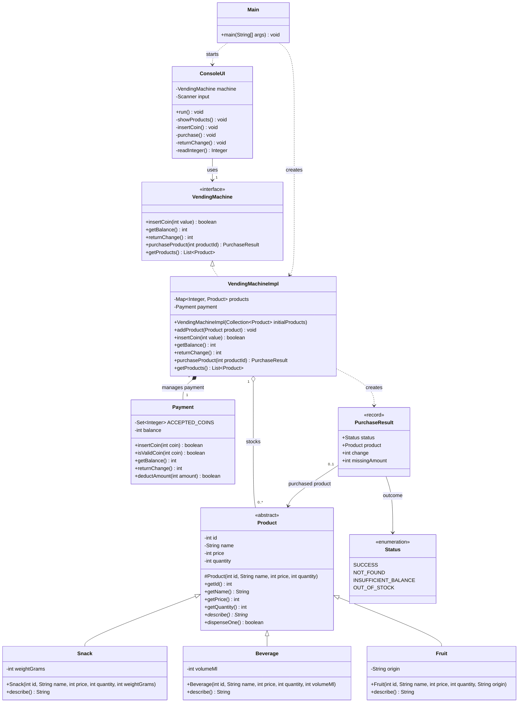

# Workshop-Vending-Machine

Maven project for the vending machine workshop. This document captures the planned object model before implementation.

## Object model

`Product` is abstract because every stocked item must provide its category-specific description. `Snack`, `Beverage`, and `Fruit` inherit common identity, price, and quantity behavior and implement that description polymorphically. The vending machine contract is an interface so the console UI can use machine behavior without depending on a particular implementation. `VendingMachineImpl` manages products and delegates balance and coin handling to `Payment`. `PurchaseResult` returns a structured outcome to the UI, which is responsible for translating it into console messages.

## Class diagram

### Key design decisions

- **Inheritance and polymorphism:** The abstract product base shares common state; each concrete product implements `describe()`. Displaying a product calls this method without checking its concrete type.
- **Encapsulation:** Product fields and machine state are private. Constructors validate their values, and stock changes through product behavior rather than direct field access.
- **Interface boundary:** `ConsoleUI` depends on `VendingMachine`, keeping input/output separate from vending machine business rules.
- **Payment encapsulation:** `Payment` owns the balance and accepted-coin rules. `VendingMachineImpl` delegates payment operations to it instead of storing or changing the balance directly.
- **Structured purchase outcome:** `PurchaseResult` lets the UI distinguish missing product, insufficient balance, out-of-stock, and successful purchases without embedding console output in machine logic.
- **Multiplicity:** One machine stocks zero or more products. A purchase result refers to a product when one was found; otherwise its product is absent.

### Business flow represented by the model

- `insertCoin` accepts only 1, 2, 5, 10, 20, or 50 kr; an invalid coin leaves the balance unchanged, and `ConsoleUI` prints the rejection message.
- `purchaseProduct` finds by id and reports `NOT_FOUND`, `OUT_OF_STOCK`, or `INSUFFICIENT_BALANCE` without changing funds or stock. The insufficient-balance result carries the missing amount. On success it dispenses one unit, deducts the price through `Payment`, and returns any remaining balance automatically as `PurchaseResult.change`.
- `returnChange` returns the entire remaining balance and resets it to zero. The UI prints the returned amount or the zero-balance message.
- `ConsoleUI.run` shows the product list and balance, repeats action prompts until exit, and shows the current balance after every action. `Product.describe()` supplies each type's detail for display and dispensing confirmation.
