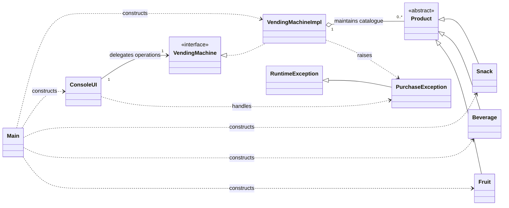
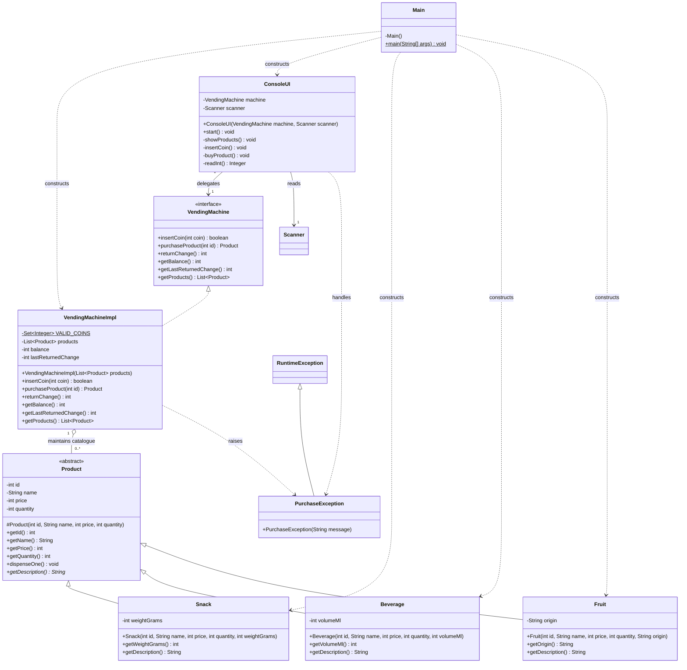

# Suggested UML Design — Lexicon Vending Machine

**Audience:** Java implementation team  
**Status:** Proposed implementation blueprint for the OOP workshop  
**Technology:** Java 17+, Maven, JUnit 5, console application

## Purpose and scope

This README is a **suggested UML design for the implementation team**, not a retrospective implementation report. Use the diagrams as the agreed starting point for dividing work, writing code, and reviewing OOP compliance. The packaged Java source is a reference implementation of this proposal; if the team changes the design, update both the diagrams and code together.

The system sells three types of products, accepts Swedish coins, validates purchases, tracks stock, returns change, and exposes a console menu. The user interface must remain separate from machine business logic. The two diagrams below intentionally serve different purposes:

1. **Overall UML:** communication of class responsibilities and relationships.
2. **Detailed UML:** a coding contract with fields, constructors, method signatures, visibility, and associations.

## 1. Suggested overall UML — class architecture



### Responsibility allocation

| Type | Proposed responsibility | Must not do |
|---|---|---|
| `Product` | Common validated product identity, price, inventory, and description contract | Read console input or process payment |
| `Snack`, `Beverage`, `Fruit` | Store category-specific information and override the description | Decide purchases or manage balance |
| `VendingMachine` | Declare the public operations exposed to a UI | Implement UI or hold mutable state |
| `VendingMachineImpl` | Own valid coins, balance, product lookup, stock reduction, and change | Read from `Scanner` or print messages |
| `ConsoleUI` | Display products, read commands, and present success or failure messages | Change stock or balance directly |
| `Main` | Assemble sample objects and start the console | Contain purchasing business rules |
| `PurchaseException` | Express domain-specific purchase failures | Control normal menu navigation |

**Arrow convention:** `<|--` inheritance; `<|..` interface realization; `o--` aggregation; `-->` navigable association; `..>` dependency. `1` denotes one instance, `0..*` denotes zero or more. `RuntimeException` is provided by Java, not a separate application source file.

## 2. Suggested detailed UML — implementation contract



**Member notation:** `+` public, `-` private, `#` protected, `*` abstract method, `$` static member. As proposed, `Product.id`, `name`, and `price` are `final`; `quantity` is mutable. Subtype-specific fields, `VendingMachineImpl.products`, `ConsoleUI.machine`, and `ConsoleUI.scanner` are `final`. `VALID_COINS` is `static final`. Product getters and `dispenseOne()` are `final` methods. Concrete application classes are `final`. The method signatures above are intended to match the provided reference source. `Scanner` and `RuntimeException` are Java library classes.

**Diagram boundaries:** Show production classes in the architecture. Keep `VendingMachineImplTest` separate because test fixtures and test methods are not part of the runtime object model.

## 3. Proposed business rules and invariants

| Area | Contract for implementers |
|---|---|
| Product identity | Product IDs must be positive and unique within a machine |
| Product validity | Nonblank name and origin; price > 0; stock >= 0; weight and volume > 0 |
| Product hierarchy | `Product` is abstract, and every concrete type provides `getDescription()`; no `instanceof` branching |
| Accepted coins | Only 1, 2, 5, 10, 20, and 50 kr; rejected coins leave balance unchanged |
| Unknown product | Purchase fails without changing the balance or any stock |
| Out of stock | Purchase fails without changing balance or stock |
| Insufficient funds | Purchase fails and reports the missing amount; state unchanged |
| Successful purchase | Reduce stock by one, deduct the price, return remaining balance automatically |
| Return change | Return the balance and reset it to zero; zero balance returns zero |
| State ownership | Only the machine owns payment state; only the product controls its inventory mutation |
| Catalogue safety | Copy the provided product list and return an unmodifiable list to callers |
| Presentation | `ConsoleUI` handles all keyboard and console operations, while `VendingMachineImpl` stays UI-independent |

**Design note:** `getLastReturnedChange()` is proposed to let the console report automatic change without parsing business messages. It represents the change from the most recent *successful purchase*; the team should document this explicitly. A richer purchase-result value object would be a reasonable future alternative, but is outside this workshop-sized design.

## 4. Reference implementation and execution

A Java reference implementation accompanies this suggested design in `src/main/java/se/lexicon/vending`, with tests in `src/test/java/se/lexicon/vending`. Its presence does **not** turn this proposal into an additional workshop requirement.

Run the included JAR:

```bash
java -jar vending-machine.jar
```

Build and run with Maven (Java 17+):

```bash
mvn clean test
mvn package
java -jar target/vending-machine-1.0.0.jar
```

The Maven tests require Maven and resolved JUnit dependencies. No database is needed.

